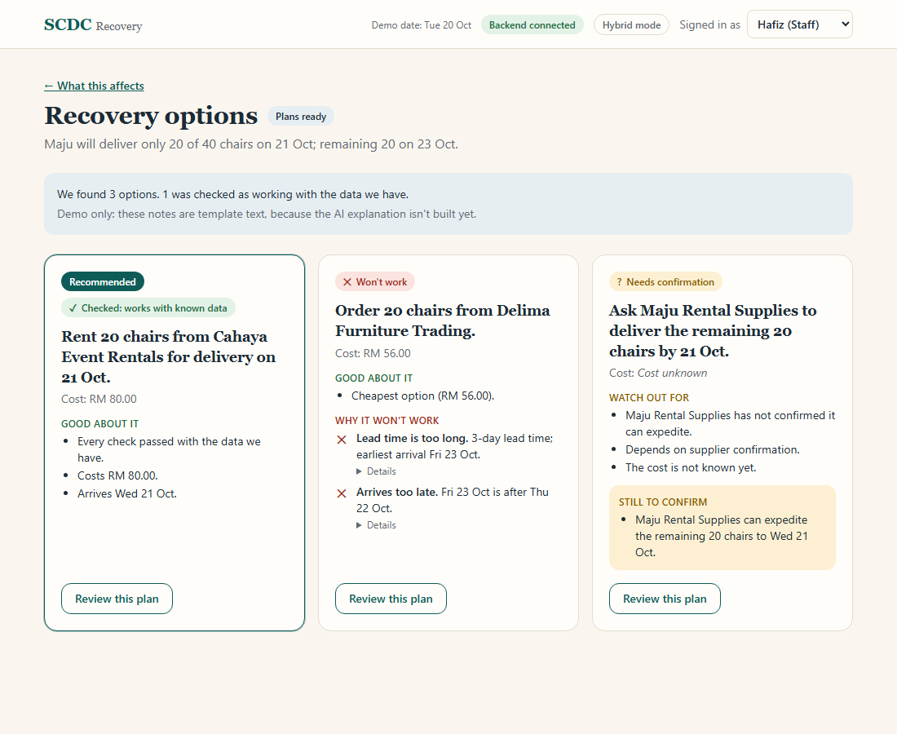
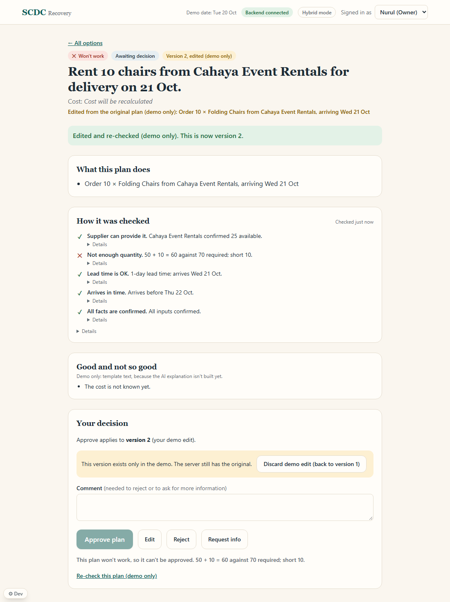
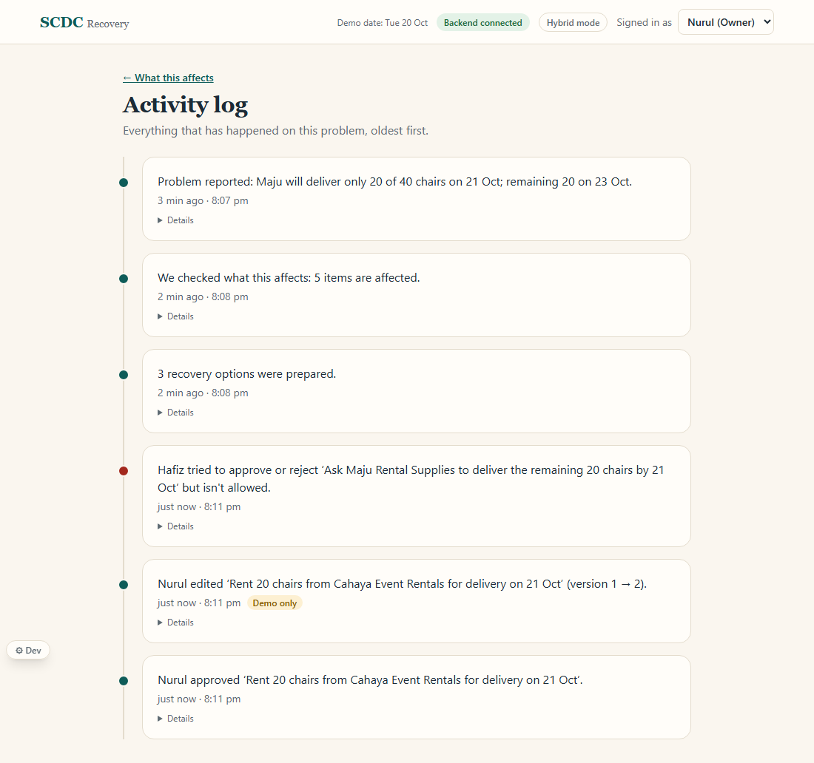
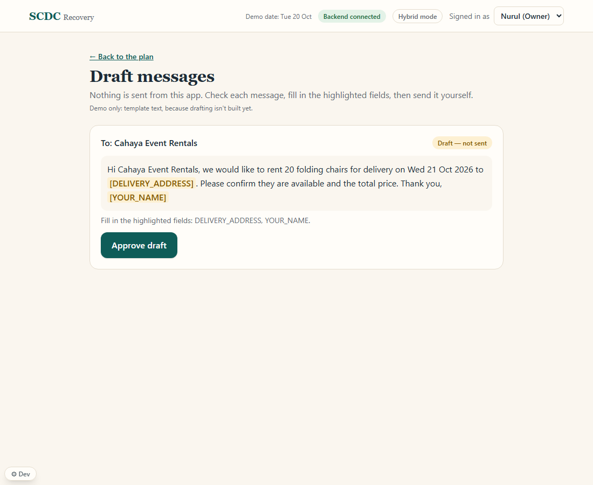

# SCDC Recovery: frontend

**What it does, in 3 lines**
1. A small business reports a supplier problem (a pasted message or a form). The app shows what it affects: events, deliveries, items.
2. It lists recovery options, each one checked by rules and shown in plain words as works, needs confirmation, or won't work.
3. The owner reviews, edits, approves or rejects. Approved plans get draft messages. **Nothing is ever sent.**

Stack: React, TypeScript, Vite, Tailwind, TanStack Query, MSW (mock API), Vitest, Playwright.



## Setup (Windows PowerShell)

You need Node 20+ and, for the real backend, Python 3.12 or newer (with `uv`, or a plain venv: see "Running Locally" in the root README). Once, from the repository root:

```powershell
cd frontend
npm install
```

## The three terminals

All paths are relative to the repository root (the backend is in `src/backend`, next to `frontend`).

| Terminal | What | Commands |
|---|---|---|
| 1. Backend | Person 2's API on port 8000, with the impact engine and AI module (skip this if you only use mock mode) | `cd src\backend` then `python -m uv run uvicorn app.main:app --reload --port 8000` |
| 2. Claude | Claude Code, for changes | from the repository root: `claude` |
| 3. Frontend | The app | `cd frontend` then `npm run dev` |

Open the address `npm run dev` prints (usually http://localhost:5173). The backend seeds itself when its database is empty.

## The three API modes

One setting, `VITE_API_MODE`. The header shows a badge with the current mode.

| Mode | What answers | Use it for |
|---|---|---|
| `hybrid` (default) | The real backend where an endpoint exists; the mocks only for what isn't built yet | Everyday development |
| `mock` | Mocks answer everything. A "Demo data (mock)" banner is shown. No backend needed | Judging day safety net, offline demo, the e2e test |
| `real` | No mocks at all. Missing endpoints show errors | Checking what the backend really has |

Pick a mode for the current terminal, then start the app:

```powershell
$env:VITE_API_MODE="mock"      # or "hybrid" or "real"
npm run dev
```

(`Remove-Item Env:VITE_API_MODE` goes back to the default.)

Add `?dev=1` to the address to show the small "⚙ Dev" panel (switch scenario, force a 500 error, let Staff press Approve to show the real 403). Judges never see it without that.

## Reset the demo

- **Mock mode:** close the tab and open it again (state lives in the browser session), or use "Reset mock" in the Dev panel.
- **Real backend:** in terminal 1 press Ctrl+C, run `python -m uv run python -m app.db.seed` (from `src\backend`), start the backend again, then reload the page.

## Checks

```powershell
npm run typecheck; npm run lint; npm test; npm run build   # all four must pass
npm run test:e2e                                           # full demo in mock mode
```

`npm run test:e2e` starts its own mock-mode dev server on port 5199 and stops it when done. It does not need the backend.

## The 2-minute demo script

Setup: mock mode (or hybrid with a freshly seeded backend), signed in as **Nurul (Owner)**. The header says "Demo date: Tue 20 Oct".

1. **Dashboard** (10 s). *"This is Seri Kenanga Events, a small event planner in Kuala Lumpur. Today is Tuesday 20 October. On Thursday we have two events, a wedding and a seminar, that need 70 folding chairs between them."* Click **Report a problem**.
2. **Report** (20 s). Click **Use the demo message**, then **Read message**. *"Maju, our chair supplier, sent a WhatsApp saying only 20 of 40 chairs arrive tomorrow. The app reads it and fills in the form. We check it, nothing is saved yet."* Click **Report and check impact**.
3. **Impact** (20 s). *"We need 70 chairs on Thursday, but only 50 will be here, so we are short 20. It traces the whole chain: Maju's delivery, the chairs, then the wedding and the seminar that depend on them. It also checks what is not affected: the birthday party on Sunday is fine, because the late chairs arrive on Friday. These results come from the rules engine, not from the screen."* Click **See recovery options**.
4. **Plans** (25 s). *"Three options. The recommended one, renting 20 chairs from Cahaya for RM 80, is checked and works. Delima is cheaper, but it arrives too late, so it is marked 'Won't work' and can't be approved. The third needs Maju to confirm. See the amber 'Still to confirm' list."* Click **Review this plan** on the recommended one.
5. **Edit** (25 s). *"What if we only rent 10?"* Click **Edit**, change 20 to 10, **Save and re-check**. *"A new version is checked again. It now says 'Not enough quantity, short 10', so Approve is off."* Click **Discard demo edit (back to version 1)**.
6. **Approve** (10 s). Click **Approve plan**. *"Only the owner can do this. Switch to Hafiz (Staff) and the buttons are off with a reason."* (Switch back to Nurul.)
7. **Log and drafts** (10 s). Click **View activity log**: *"Every step is recorded with who did it."* Go back, click **Prepare messages**: *"Drafts only. The yellow fields need filling, and nothing is sent."* Click **Approve draft**.

Closing line: *"AI proposes, the rules verify, a human decides."*

## Integration status

The real backend (Person 2) has most endpoints; a few are mocked until their owners ship. Full details, differences from the contract, and the asks for Person 2 are in [INTEGRATION_GAPS.md](INTEGRATION_GAPS.md).

| Area | Status |
|---|---|
| Lists (jobs, suppliers, resources, deliveries, dependencies) | Real |
| Report, analyze, impact, plans, approve, reject | Real |
| Request more info, activity log, duplicate-report 409, error `code` | Real |
| Dashboard | Built in the frontend from real lists |
| Read message (extract), explanation | Mock (waiting for Person 5) |
| Edit and re-check a plan | Mock (waiting for Person 4's validation) |
| Draft messages and approve draft | Mock (waiting for Person 5) |

The list lives in code in `src/mocks/missing-endpoints.ts`.

## Known limitations

- **Mocked parts are labelled "Demo only"** in the screen. Edits exist only in the browser: the real backend doesn't know about them, so a demo edit can't be approved on the server by anyone else. "Discard demo edit" drops it.
- The edit rules are scripted: 20 → 10 chairs gives "short 10"; any other edit gives "Needs confirmation" because no real validation runs.
- Explanations and drafts are template text, not AI. They carry no "AI-generated" badge for that reason.
- Scenario B ("no feasible plan", `src/mocks/scenarios/no_feasible.json`) is mock-only and applies to plans generated in mock mode.
- Money and dates follow the data: unknown costs say "Cost unknown", times show in Asia/Kuala_Lumpur, and "today" is fixed to the demo date (20 Oct 2026), not the real calendar.
- Nothing in this app sends a message, anywhere.

## Folder map

```
src/api/      the only place that calls the backend (client.ts, endpoints.ts, errors.ts)
src/mocks/    MSW handlers, fixtures-based mock data, scenarios/
src/pages/    Dashboard, ReportDisruption, Impact, Plans, PlanReview, Drafts, ActivityLog
src/lib/      formatting, plan wording rules, activity sentences, name lookups
src/types/    api.generated.ts (from the backend, never edit by hand), contracts.ts
e2e/          the Playwright demo test
```

Regenerate the API types after the backend changes (backend running): `npm run gen:api`.




